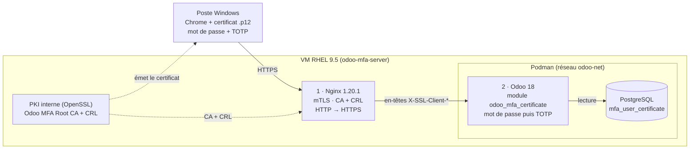

# Architecture

## Flux de connexion

1. Le navigateur présente son certificat client. **Nginx** vérifie la signature de la CA, la validité et la CRL. Sinon : `400`.
2. Nginx transmet l'identité du certificat à Odoo (`X-SSL-Client-Verify`, `-S-DN`, `-I-DN`, `-Serial`, `-Fingerprint`), en réécrivant ces en-têtes à chaque requête.
3. Au `POST /web/login`, le module recherche le **numéro de série** dans `mfa_user_certificate` et contrôle, dans l'ordre :
   1. certificat enregistré ;
   2. état `active` ;
   3. date de fin non dépassée ;
   4. propriétaire = utilisateur du login saisi.
4. Odoo contrôle le **mot de passe**, puis le **code TOTP** si l'utilisateur l'a activé (`auth_totp`).

## Messages de refus (préfixe « MFA authentication failed: »)

| Cause | Message |
|---|---|
| Série inconnue | Certificate is not registered in Odoo |
| État suspendu / révoqué | Certificate status is suspended / revoked |
| Date de fin dépassée | Certificate has expired |
| Autre utilisateur | Certificate does not belong to this Odoo user |
| En-têtes mTLS absents | Client certificate required |

Chaque refus est journalisé : `X509 MFA denied for login=… serial=… reason=…`.

## Deux niveaux de révocation

- **PKI (CRL)** : bloque dès Nginx, avant l'application (`pki/revoke.sh`).
- **Odoo (état du certificat)** : suspension ou révocation applicative, plus fine, sans toucher à la CRL.
